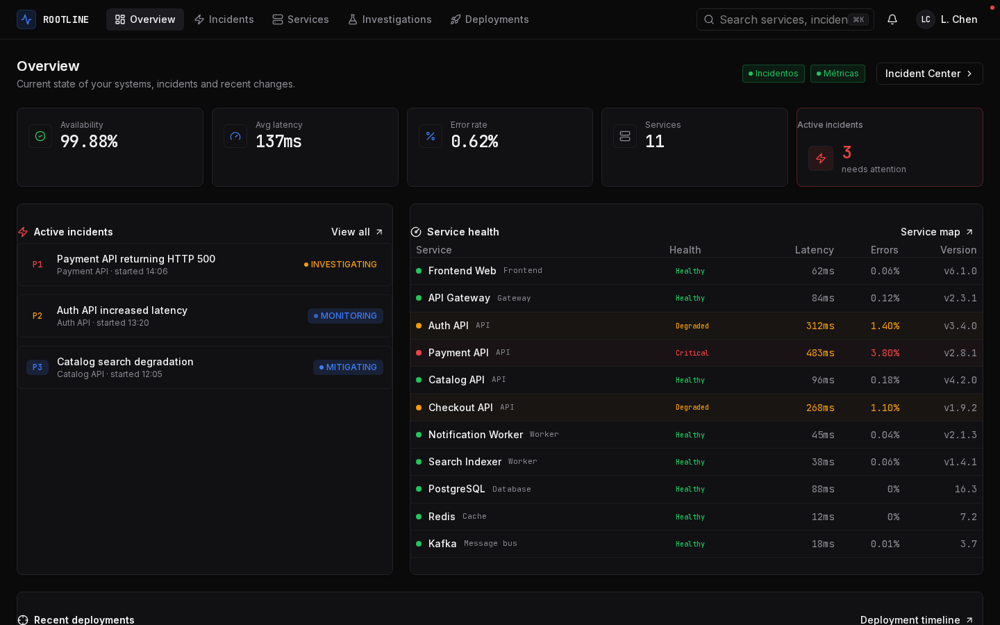
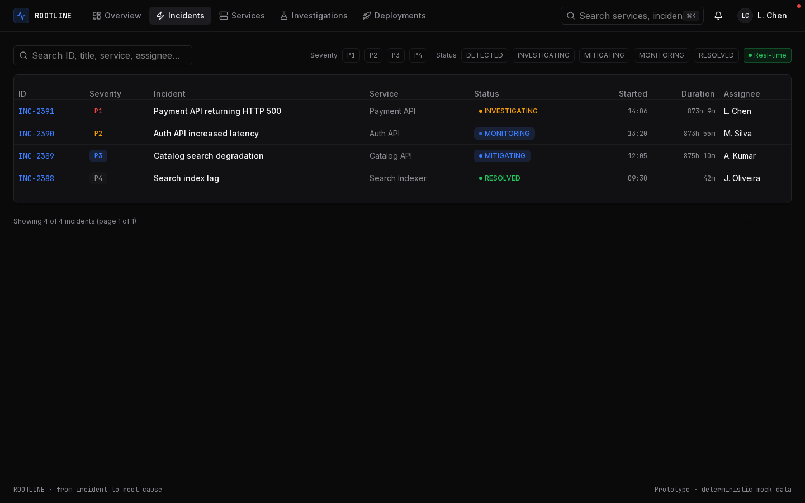
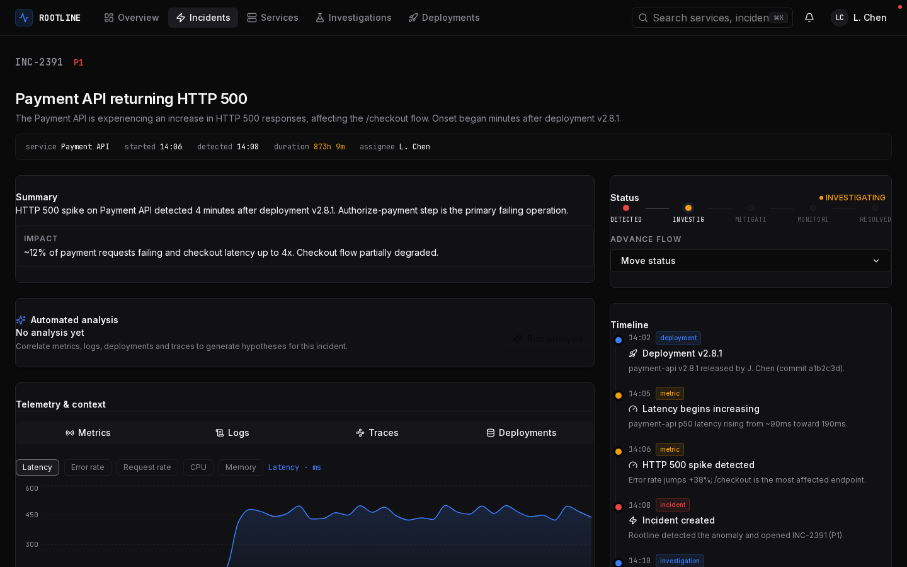
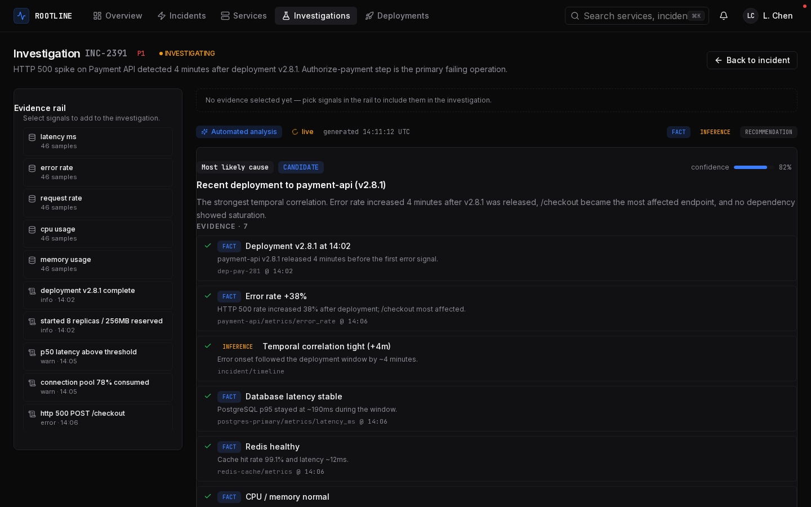
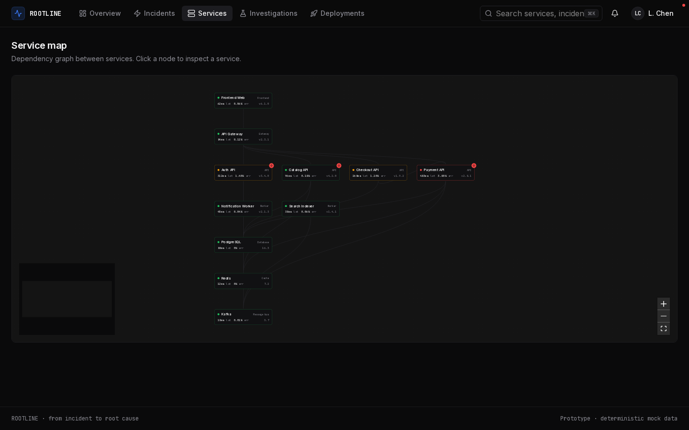
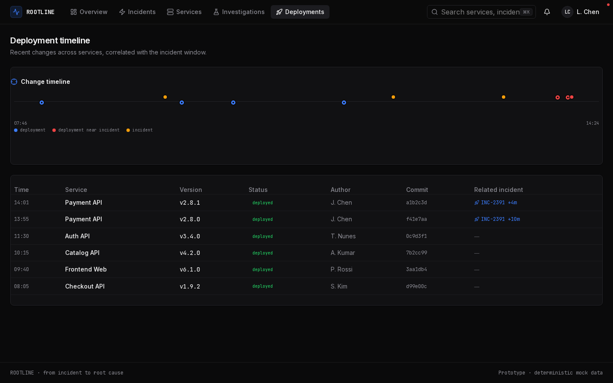
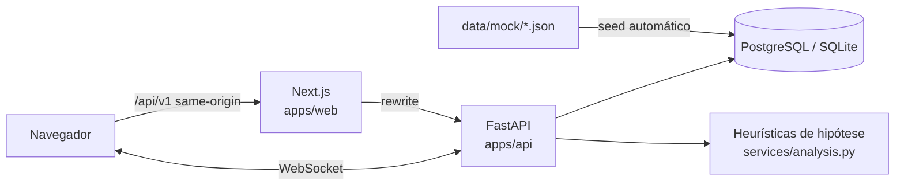

# Rootline

**Do incidente à causa-raiz: protótipo de portfólio.**

## O que é

O Rootline é um **protótipo de portfólio** de uma plataforma de investigação de incidentes. Tem um dashboard web (Next.js) e uma API (FastAPI) que, hoje, trabalham **apenas com dados mock determinísticos** gerados por `data/scripts/generate-mock.mjs` e gravados em `data/mock/*.json`. A API carrega esses dados num banco (PostgreSQL ou SQLite) e expõe incidentes, serviços, deployments, investigações e métricas por REST e WebSocket. A "investigação" gera hipóteses por **regras heurísticas fixas**, sem IA nem modelo de linguagem (veja [Limitações conhecidas](#limitações-conhecidas)).

## Status

[](https://github.com/dev-christianmendes/rootline/actions/workflows/ci.yml)

- Protótipo em desenvolvimento, **sem deploy público**.
- Todas as telas abaixo foram capturadas da aplicação real rodando localmente (`npm run infra:up` + `next start`) com o dataset mock.

## Telas

|                                                                      |                                                                       |
| -------------------------------------------------------------------- | --------------------------------------------------------------------- |
|        |  |
| **Visão geral**: saúde dos serviços, incidentes ativos               | **Central de incidentes**                                             |
|  |   |
| **Incidente**: timeline, status e telemetria                         | **Investigação**: hipóteses heurísticas e evidências                  |
|          |                |
| **Mapa de dependências**                                             | **Timeline de deployments** correlacionada a incidentes               |

## Funcionalidades reais

**Web** (`apps/web/app`)

- Dashboard (`/`) com saúde dos serviços, incidentes ativos e deployments recentes.
- Central de incidentes (`/incidents`) e detalhe (`/incidents/[id]`) com timeline, fluxo de status, telemetria e diálogos para criar e resolver incidentes.
- Investigações (`/investigations`, `/investigations/[id]`) com cards de hipótese e grafo de evidências (`@xyflow/react`).
- Serviços (`/services`, `/services/[id]`) com mapa de dependências e gráficos de métricas (Recharts).
- Timeline de deployments (`/deployments`).
- Atualização em tempo real via WebSocket (`apps/web/hooks/use-*-websocket.ts`), paginação e preferência de locale.

**API** (`apps/api/app`)

- 20 rotas HTTP sob `/api/v1`: health/ready/live, system, services, incidents, investigations, deployments e auth (`login`, `register`, `me`).
- 3 WebSockets: `/ws/incidents/{incident_id}`, `/ws/services/{service_id}/metrics` e `/ws/logs` (`app/websockets/router.py`).
- Autenticação JWT nas rotas de escrita (`app/auth/`) e rate limiting com slowapi (`app/rate_limiter.py`).
- Métricas Prometheus **da própria API** e logs estruturados com structlog (`app/observability.py`).
- Seed automático a partir de `data/mock` quando o banco está vazio (`ROOTLINE_AUTO_SEED`). Migrations com Alembic.

## Stack

| Camada  | Tecnologias (versões dos manifests)                                                                                                                  |
| ------- | ---------------------------------------------------------------------------------------------------------------------------------------------------- |
| Web     | Next.js ^15.1, React ^19, TypeScript ^5.7, TanStack Query ^5, Zustand ^5, @xyflow/react ^12, Recharts ^3, Tailwind CSS ^4, framer-motion ^12         |
| API     | Python 3.12 (Dockerfile/CI), FastAPI 0.141, SQLAlchemy 2.0, Alembic 1.13, Pydantic 2.13, python-jose, passlib, slowapi, prometheus-client, structlog |
| Banco   | PostgreSQL 16 (Docker Compose) ou SQLite (testes)                                                                                                    |
| Testes  | pytest, Playwright ^1.63                                                                                                                             |
| Tooling | npm workspaces, husky, commitlint (Conventional Commits), lint-staged, Prettier, changesets                                                          |

## Arquitetura

```
rootline/
├── apps/
│   ├── web/          # Next.js (App Router), proxy /api/v1 → API
│   └── api/          # FastAPI + SQLAlchemy + Alembic, Dockerfile, docker-compose.yml
├── packages/
│   ├── ui/           # componentes e tokens de design compartilhados
│   ├── types/        # tipos de domínio em TypeScript
│   └── config/       # presets de tsconfig
├── data/
│   ├── mock/         # datasets determinísticos (services, incidents, logs, metrics, traces…)
│   └── scripts/      # gerador do mock
└── docs/             # ADRs, arquitetura, runbooks
```



O navegador sempre fala com `/api/v1` na mesma origem. O Next.js repassa as chamadas para a API (`apps/web/next.config.ts`; ADR 002).

## Como rodar

Pré-requisitos: Node ≥ 20, Python 3.12 e Docker.

```bash
npm install

# API + PostgreSQL via Docker Compose (apps/api/docker-compose.yml)
npm run infra:up          # sobe postgres + api em http://localhost:8000
npm run infra:logs        # logs da API
npm run infra:down        # para os containers
npm run infra:reset       # recria o volume e refaz o seed

# Frontend
npm run dev               # http://localhost:3000
```

Para rodar a API sem Docker:

```bash
npm run api:install       # cria apps/api/.venv e instala requirements-dev.txt
npm run api:dev           # uvicorn com reload na porta 8000
```

Variáveis de ambiente: copie `.env.example` para `.env`. Defina um `ROOTLINE_SECRET_KEY` próprio. O valor padrão serve só para desenvolvimento.

## Testes

| Suíte                | Onde                | Tamanho                           |
| -------------------- | ------------------- | --------------------------------- |
| API (pytest)         | `apps/api/tests/`   | 3 arquivos, 26 testes             |
| E2E (Playwright)     | `apps/web/e2e/`     | 3 specs, 18 testes                |
| Determinismo do mock | `npm run test:mock` | compara `data/mock` com o gerador |

```bash
npm test                                  # typecheck + lint + test:mock + api:test
npm run api:test                          # pytest em SQLite temporário
ROOTLINE_TEST_DATABASE_URL=postgresql+psycopg://... npm run api:test   # mesma suíte em PostgreSQL
npm run test:e2e --workspace @rootline/web # Playwright (sobe o Next em :3000; precisa da API rodando)
```

No CI (`.github/workflows/ci.yml`), a suíte da API roda em SQLite **e** em PostgreSQL. Os testes E2E ainda **não** rodam no CI, e a cobertura ainda não é medida.

## Decisões

Os registros de decisão ficam em [`docs/adr/`](docs/adr/index.md):

- [001: Monorepo com npm workspaces](docs/adr/001-monorepo-workspaces.md)
- [002: Proxy do Next.js para a API (sem CORS)](docs/adr/002-nextjs-proxy.md)
- [003: Tabela plana `metric_points`](docs/adr/003-flat-metrics-table.md)
- [004: Seed determinístico](docs/adr/004-deterministic-seed.md)
- [005: Autenticação JWT stateless](docs/adr/005-jwt-auth.md)

Arquitetura e runbooks: [`docs/architecture/`](docs/architecture/index.md) e [`docs/runbooks/`](docs/runbooks/).

## Limitações conhecidas

- **Só dados mock.** Toda a telemetria (métricas, logs, traces, deployments) vem de `data/mock`. Não há coleta de nenhuma fonte real.
- **A "análise" é heurística, sem IA.** `apps/api/app/services/analysis.py` se descreve como _mock implementation_. Cada hipótese sai de uma regra simples (deploy recente, pico de error rate ou de latência…) com confiança fixa (0.75, 0.65, 0.60…). O atraso de "processamento" é simulado (`ROOTLINE_ANALYSIS_DELAY_MS`).
- **Sem integração** com Prometheus, Grafana, Loki, Tempo ou Jaeger. O endpoint de métricas Prometheus expõe só métricas da própria API.
- O frontend **não tem tela de login**. O JWT existe só na API.
- Há Dockerfile apenas para a API. A web roda com `next dev` ou `next start`.
- Os testes E2E não rodam no CI e não há relatório de cobertura.
- Os horários do dataset são fixos; por isso a duração de incidentes ainda abertos cresce com o tempo (ex.: "873h").

## Roadmap

- [x] Deixar o CI verde.
- [ ] Endurecer os gates de segurança (pip-audit e npm audit ainda não bloqueiam).
- [ ] Rodar os testes E2E no CI e medir cobertura (pytest-cov).
- [x] Publicar screenshots reais.
- [ ] Primeira integração real: ler métricas de um Prometheus.
- [ ] Ingestão de logs e traces (Loki, Tempo ou Jaeger).
- [ ] Tela de login no frontend.
- [ ] Avaliar hipóteses com um modelo de linguagem, mantendo as evidências rastreáveis.

## Licença

[MIT](LICENSE)
