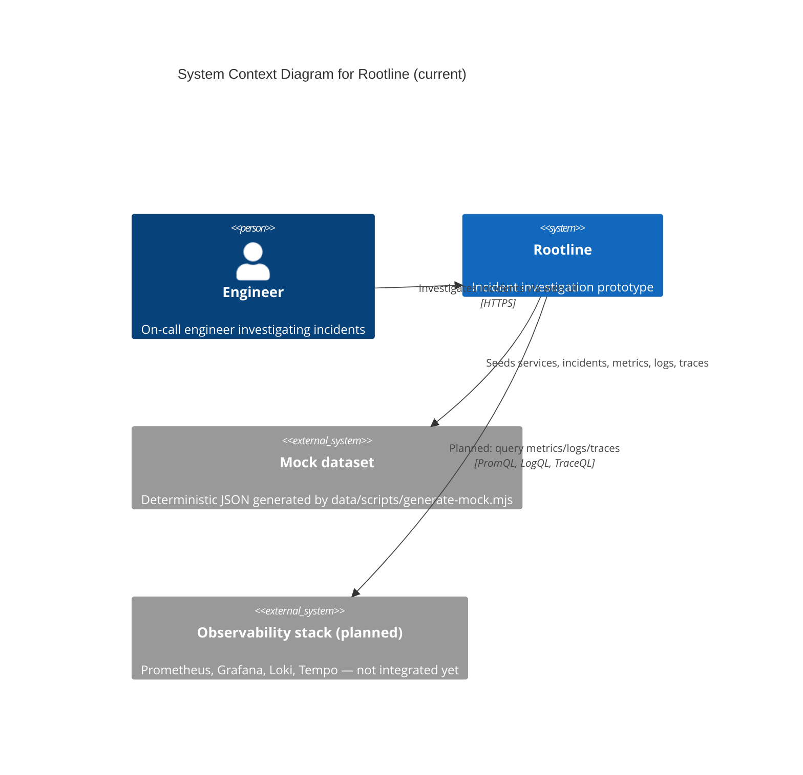
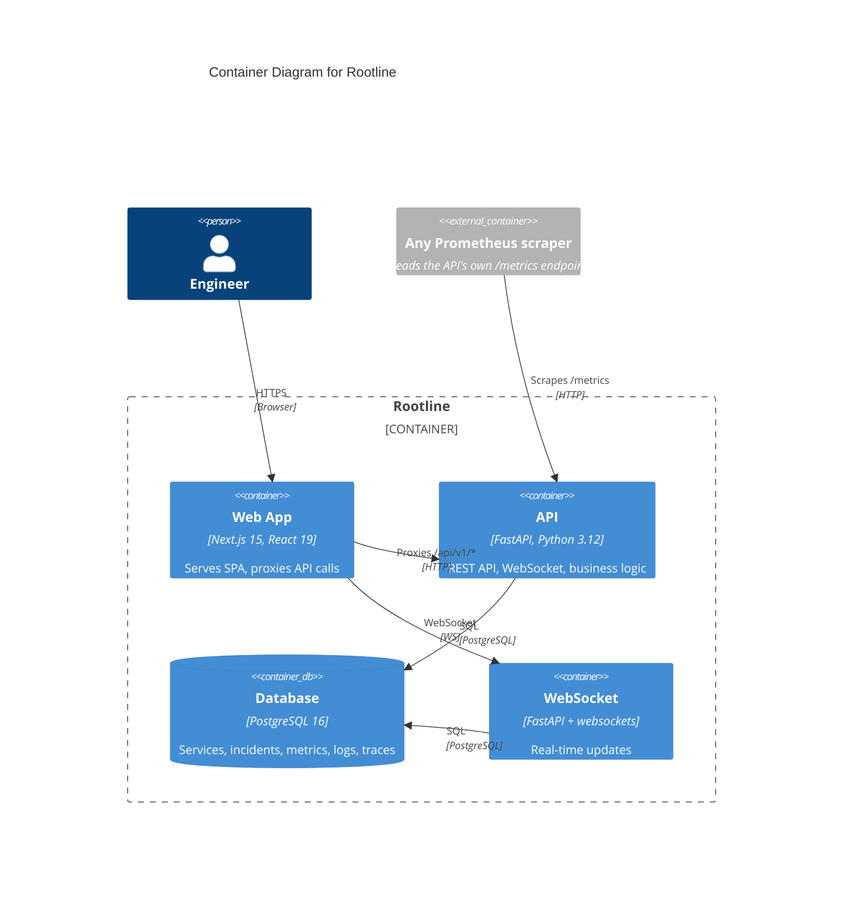
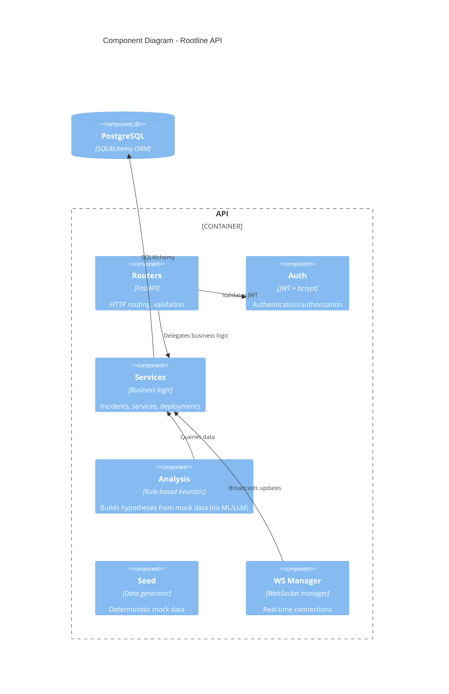
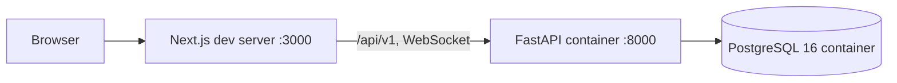

# Architecture Documentation

This directory contains architecture diagrams and documentation for Rootline.

> **Current state:** Rootline is a portfolio prototype. The API serves deterministic mock data
> (`data/mock/*.json`) and the analysis engine is a rule-based heuristic. Integrations with
> Prometheus, Grafana, Loki or Tempo are **planned, not implemented**. Diagrams below show what
> exists today; planned pieces are labelled as such.

## C4 Model Diagrams

### System Context (Level 1)

### Container Diagram (Level 2)

### Component Diagram - API (Level 3)

## Deployment Architecture

Today Rootline runs locally only: the API and PostgreSQL via Docker Compose
(`apps/api/docker-compose.yml`) and the web app with `npm run dev`. There is no
public deployment and no Kubernetes manifest in the repository.

## Technology Stack

| Layer    | Technology           | Version           |
| -------- | -------------------- | ----------------- |
| Frontend | Next.js (App Router) | 15.x              |
| Frontend | React                | 19.x              |
| Frontend | TypeScript           | 5.x               |
| Frontend | TanStack Query       | 5.x               |
| Frontend | Tailwind CSS         | 4.x               |
| Backend  | FastAPI              | 0.115+            |
| Backend  | Python               | 3.12              |
| Backend  | SQLAlchemy           | 2.0               |
| Backend  | PostgreSQL           | 16                |
| Backend  | Alembic              | 1.13              |
| Backend  | WebSockets           | websockets 13     |
| Backend  | Prometheus           | prometheus-client |
| Backend  | Logging              | structlog         |
| Infra    | Docker               | 24+               |
| CI/CD    | GitHub Actions       | -                 |

## Data Flow

### Incident Creation

1. Engineer creates incident via Web UI
2. Web → API `POST /incidents` (JWT auth)
3. API validates, creates incident in PostgreSQL
4. API broadcasts via WebSocket to connected clients
5. WebSocket clients receive real-time update

### Real-time Metrics

1. Frontend connects to `/ws/services/{id}/metrics`
2. API streams metric updates via WebSocket
3. Frontend updates charts in real-time

### Incident Analysis

1. Engineer clicks "Analyze" on incident
2. API `POST /incidents/{id}/analyze`
3. Analysis service (rule-based heuristic over the mock dataset, fixed confidence weights) correlates:
   - Recent deployments to affected services
   - Metric anomalies (error rate, latency spikes)
   - Error logs and traces
   - Dependency health
4. Returns hypotheses with evidence/counter-evidence
